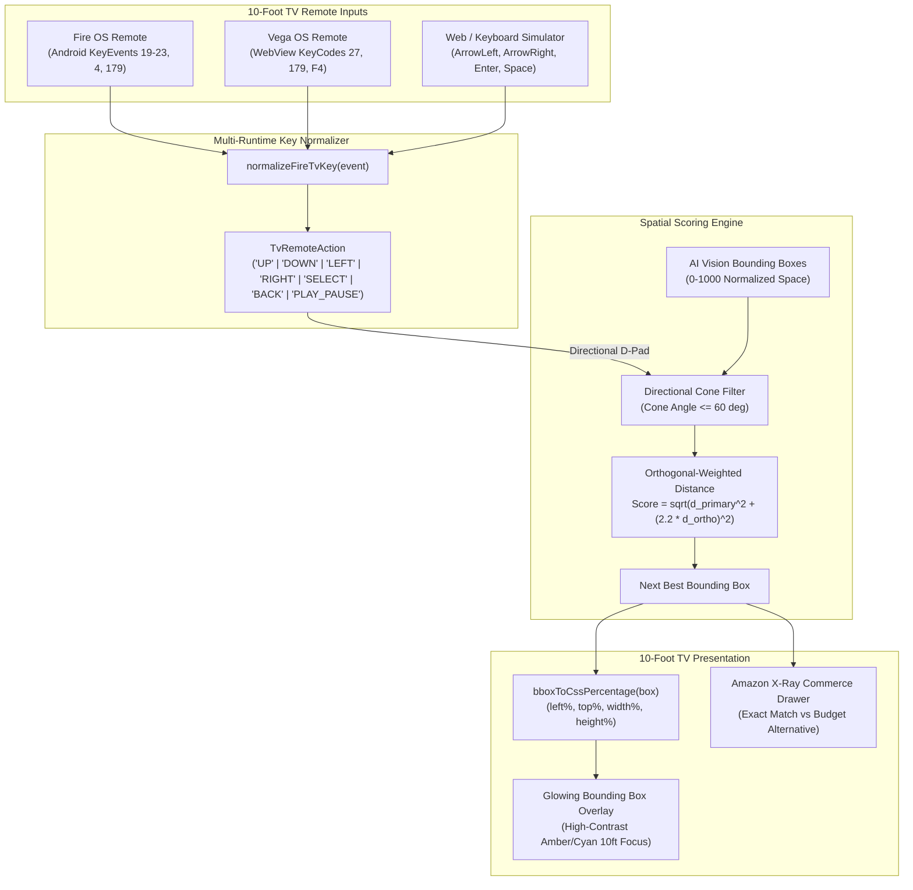

# tv-bbox-navigator

[](https://www.npmjs.com/package/tv-bbox-navigator)
[](LICENSE)
[](package.json)
[](https://amazon.com)

> **Framework-agnostic Spatial D-Pad Navigation Engine for 10-foot Smart TVs.**  
> Effortlessly maps normalized 0-1000 computer vision bounding boxes (`x_min`, `y_min`, `x_max`, `y_max`) to discrete TV remote directional inputs (`UP`, `DOWN`, `LEFT`, `RIGHT`) using **directional cone validation** and **orthogonal-weighted Euclidean distance scoring**.

Created by **Artur Nurullin** ([Nuculo Incorporated](https://github.com/nuculo)) as the open-source companion library for **Amazon LookUp** (Amazon Developer Hackathon).

---

## The Problem

Traditional web spatial navigation libraries (such as the W3C CSS Spatial Navigation Polyfill) expect static, focusable DOM elements (`<button>`, `<a>`, `<input>`) laid out in standard HTML flow. 

When building **AI-enhanced Shoppable TV (X-Ray)** experiences:
1. **Dynamic Video Overlays**: Bounding boxes are generated in real-time by Vision AI models (e.g., **AWS Bedrock Nova / Claude 3.5 Sonnet Vision**) across paused video frames.
2. **0-1000 Coordinate Spaces**: Vision models output normalized coordinates (`x_min`, `y_min`, `x_max`, `y_max` in integer range `0..1000`), not rendered pixel dimensions.
3. **Fragmented TV Remote Inputs**: Amazon Fire OS WebViews, Vega OS WebViews, and host TV simulators emit divergent key event codes (`keyCode: 4` vs `27` for Back; `179` vs `85` vs `F4` for Play/Pause; `19..23` for Android KeyEvents).
4. **Diagonal Drift on 10-Foot UI**: Naive shortest Euclidean distance jumps diagonally between products (e.g. from a watch on a wrist to boots on the ground) when the living room viewer clearly pressed `RIGHT`.

`tv-bbox-navigator` solves all four problems with zero external dependencies in under 3KB gzipped.

---

## Architecture Diagram



---

## Mathematical Scoring Model

When navigating from current active box $A$ with center $(cx_A, cy_A)$ toward candidate $B$ with center $(cx_B, cy_B)$ in direction $D \in \{\text{UP}, \text{DOWN}, \text{LEFT}, \text{RIGHT}\}$:

### 1. Primary & Orthogonal Displacements
| Direction | Primary Displacement ($d_{\text{primary}}$) | Orthogonal Displacement ($d_{\text{ortho}}$) | Forward Condition |
| :--- | :--- | :--- | :--- |
| **`RIGHT`** | $cx_B - cx_A$ | $\|cy_B - cy_A\|$ | $d_{\text{primary}} > 0$ |
| **`LEFT`** | $-(cx_B - cx_A)$ | $\|cy_B - cy_A\|$ | $d_{\text{primary}} > 0$ |
| **`DOWN`** | $cy_B - cy_A$ | $\|cx_B - cx_A\|$ | $d_{\text{primary}} > 0$ |
| **`UP`** | $-(cy_B - cy_A)$ | $\|cx_B - cx_A\|$ | $d_{\text{primary}} > 0$ |

### 2. Angular Cone Check
$$\theta = \arctan2(d_{\text{ortho}}, d_{\text{primary}}) \times \frac{180^\circ}{\pi}$$
Candidates satisfying $\theta \le \theta_{\text{cone}}$ (default $60^\circ$) lie inside the forward cone.

### 3. Orthogonal Penalty Metric
$$\text{Score}(A, B) = \sqrt{d_{\text{primary}}^2 + (w_{\text{ortho}} \cdot d_{\text{ortho}})^2}$$
- Default $w_{\text{ortho}} = 2.2$.
- The orthogonal weight heavily penalizes vertical drift when moving horizontally, ensuring natural living-room navigation.

---

## Installation

```bash
npm install tv-bbox-navigator
```

*(Zero runtime dependencies. Pure TypeScript / JavaScript.)*

---

## Usage

### 1. Simple Functional Usage
```ts
import { findNextBoundingBox, bboxToCssPercentage, type BoundingBox } from 'tv-bbox-navigator';

const detectedItems: BoundingBox[] = [
  { id: 'watch', x_min: 470, y_min: 540, x_max: 560, y_max: 650 },
  { id: 'sunglasses', x_min: 430, y_min: 170, x_max: 610, y_max: 250 },
  { id: 'jacket', x_min: 300, y_min: 360, x_max: 720, y_max: 860 },
];

// Current focused item is 'jacket', user pressed UP on Fire TV remote:
const nextItem = findNextBoundingBox(detectedItems, 'jacket', 'UP');
console.log(nextItem?.id); // -> 'sunglasses'

// Convert 0-1000 coordinate to CSS style percentages for full-screen overlay:
const css = bboxToCssPercentage(nextItem!);
// -> { left: '43%', top: '17%', width: '18%', height: '8%' }
```

### 2. Multi-Runtime Keycode Normalizer
Supports all Amazon Fire TV and Vega OS remote key codes:

```ts
import { normalizeFireTvKey } from 'tv-bbox-navigator';

window.addEventListener('keydown', (event) => {
  const action = normalizeFireTvKey(event);

  switch (action) {
    case 'LEFT':
    case 'RIGHT':
    case 'UP':
    case 'DOWN':
      console.log(`D-Pad navigation: ${action}`);
      break;
    case 'SELECT':
      console.log('User pressed Enter / D-Pad Center');
      break;
    case 'PLAY_PAUSE':
      console.log('Media key / Space / S pressed');
      break;
    case 'BACK':
      console.log('Fire TV Back key / Escape pressed');
      break;
  }
});
```

### 3. Object-Oriented `SpatialNavigator`
```ts
import { SpatialNavigator } from 'tv-bbox-navigator';

const navigator = new SpatialNavigator(detectedItems, {
  coneAngleDeg: 60,
  orthogonalWeight: 2.2,
  wrap: true, // Wrap around opposite screen edge when reaching boundary
});

navigator.onFocusChange((box, direction) => {
  console.log(`Active box changed to: ${box?.id} via ${direction}`);
});

navigator.onAction((action) => {
  if (action === 'SELECT') {
    addToCart(navigator.getFocusedBox());
  }
});

// Automatically bind to global window keydown events:
const cleanup = navigator.attach();
```

### 4. React 18 Hook Integration Example
```tsx
import React, { useEffect, useState } from 'react';
import { SpatialNavigator, bboxToCssPercentage, type BoundingBox } from 'tv-bbox-navigator';

export function ShoppableVideoOverlay({ items }: { items: BoundingBox[] }) {
  const [activeId, setActiveId] = useState<string | null>(items[0]?.id ?? null);

  useEffect(() => {
    const nav = new SpatialNavigator(items, { wrap: true });
    nav.focus(activeId);

    nav.onFocusChange((box) => {
      if (box) setActiveId(box.id);
    });

    const cleanup = nav.attach();
    return cleanup;
  }, [items]);

  return (
    <div className="absolute inset-0 pointer-events-none">
      {items.map((item) => {
        const isFocused = item.id === activeId;
        const style = bboxToCssPercentage(item);

        return (
          <div
            key={item.id}
            style={style}
            className={`absolute transition-all ${
              isFocused ? 'ring-4 ring-amber-400 bg-amber-500/20' : 'border-2 border-cyan-400/50'
            }`}
          />
        );
      })}
    </div>
  );
}
```

---

## Keycode Reference Matrix

| Remote Input | Fire OS WebView | Vega OS WebView | Android TV | Web Browser | Normalized Action |
| :--- | :--- | :--- | :--- | :--- | :--- |
| **D-Pad Up** | `keyCode 19` | `keyCode 38` | `KEYCODE_DPAD_UP (19)` | `ArrowUp` | `'UP'` |
| **D-Pad Down** | `keyCode 20` | `keyCode 40` | `KEYCODE_DPAD_DOWN (20)` | `ArrowDown` | `'DOWN'` |
| **D-Pad Left** | `keyCode 21` | `keyCode 37` | `KEYCODE_DPAD_LEFT (21)` | `ArrowLeft` | `'LEFT'` |
| **D-Pad Right** | `keyCode 22` | `keyCode 39` | `KEYCODE_DPAD_RIGHT (22)` | `ArrowRight` | `'RIGHT'` |
| **Select / Enter** | `keyCode 23` | `keyCode 13` | `KEYCODE_DPAD_CENTER (23)` | `Enter` | `'SELECT'` |
| **Play / Pause** | `keyCode 179` | `keyCode 115 (F4)` | `KEYCODE_MEDIA_PLAY_PAUSE (85)` | `MediaPlayPause` / `Space` | `'PLAY_PAUSE'` |
| **Back Button** | `keyCode 4` | `keyCode 27` | `KEYCODE_BACK (4)` | `Escape` / `Backspace` | `'BACK'` |

---

## How Amazon LookUp Uses `tv-bbox-navigator`

In **Amazon LookUp** (AI Shoppable TV for Amazon Fire TV & Vega OS):
1. Pausing the video triggers real-time frame extraction and sends the frame to **AWS Bedrock / Claude 3.5 Sonnet Vision**.
2. The vision backend returns detected fashion and lifestyle items with normalized 0-1000 coordinates.
3. `tv-bbox-navigator` receives these bounding boxes and binds directly to the Fire TV remote D-Pad.
4. As the user presses `LEFT` and `RIGHT` from their living room couch, the navigator jumps between items on screen without requiring a mouse pointer or touch screen.
5. Pressing `UP` and `DOWN` toggles between the **Exact Match** and **Budget "Get the Look"** alternative in the slide-over Amazon X-Ray Commerce Drawer.

---

## Testing

```bash
npm test
```

Includes unit test suites validating:
- Multi-runtime keycode normalization
- 0-1000 coordinate percentage conversion
- Directional cone angular filtering & orthogonal weighting
- Boundary wrapping & edge cases
- `SpatialNavigator` event lifecycle

---

## License

MIT License &copy; 2026 Nuculo Incorporated / Artur Nurullin.
